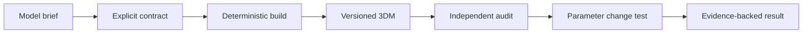

# Rhino 7 rebuild (local working copy)

This checkout is the **Rhino 7 modified work** at `D:\AI_Dev_Work\2026y\26y_09m_29d_SoDam\rhino7-work`. The untouched original is stored separately in the sibling `upstream-source` folder. The installed Codex skill at `C:\Users\PC\.agents\skills\rhino-architectural-modeling` points to this working copy.

Start with [RHINO7_README.md](RHINO7_README.md) for the Rhino 7 offline generation, audit, tests, and first run. The upstream README below describes its original Rhino 8 and MCP workflow; its installation commands would install the upstream version, not this Rhino 7 rebuild.

---
# Rhino Architectural Modeling

A reusable Agent Skill for planning, generating, auditing, and regression-testing conceptual architectural models in Rhino 8.

It combines deterministic RhinoCommon modelling, explicit model contracts, live geometry QA, parameter-change tests, and collaboration rules that work with one agent or a larger agent team.

> This repository contains the Skill itself. Start with this README to install it; agents should treat [`SKILL.md`](SKILL.md) as the operational authority.

## Why use it?

AI can generate convincing Rhino geometry while still missing dimensions, leaving open solids, duplicating members, drifting from the saved script, or silently failing to propagate a parameter change. This Skill turns those risks into explicit checks.

- Define units, axes, envelopes, layers, names, counts, contacts, and clearances before modelling.
- Generate repeatable RhinoCommon geometry without depending on selection or UI state.
- Preserve a versioned known-good `.3dm` before changes.
- Recompute geometry metrics independently from the build summary.
- Prove parametric behaviour with baseline and parameter-only change tests.
- Coordinate one or more agents while maintaining exactly one Rhino document writer.



## Suitable tasks

- Parametric pavilions and entrance canopies
- Portal frames and conceptual structural grids
- Facade, screen, and louver systems
- Roof and spatial-envelope studies
- Deterministic `.3dm` generation
- Existing-model geometry audits
- Single-agent or multi-agent Rhino workflows

This Skill is intended for conceptual modelling and QA. It does not provide structural certification, building-code review, fabrication detailing, waterproofing design, or constructability approval.

## Requirements

- A host that supports standalone Agent Skills, such as Codex in the ChatGPT desktop app, Codex CLI, or the Codex IDE extension.
- Rhino 8 for live modelling.
- A compatible Rhino MCP connection for live document inspection, Python execution, saves, and viewport capture.
- Python 3 for the standalone metric-comparison utility.

Rhino MCP is not bundled with this repository. [McNeel's RhinoMCP](https://github.com/mcneel/RhinoMCP) is an official Rhino project with setup guidance for Codex and other assistants. MCP implementations expose different tool names and execution contracts, so confirm that the selected server can target the intended Rhino document and execute RhinoCommon code before allowing writes.

Without Rhino MCP, the Skill can still help create model briefs, review generators, calculate expected geometry, and compare saved metric JSON files, but it cannot inspect or mutate a live Rhino document.

## Install with an AI agent

Paste this into Codex or another coding agent that can manage local files:

```text
Install the Agent Skill from:
https://github.com/leoyang1984/rhino-architectural-modeling

For Codex, install it as the user skill:
$HOME/.agents/skills/rhino-architectural-modeling

Before changing anything:
1. Inspect the repository and confirm that SKILL.md exists.
2. If the destination already exists, do not overwrite or delete it. Report what is there and ask whether to update it.
3. Install only this repository, not its parent directory or unrelated files.
4. Verify that the installed SKILL.md is readable.
5. Report the exact installed path and show how to invoke $rhino-architectural-modeling.
6. Do not configure or run Rhino MCP unless I separately authorize it.
```

AI agents using a different host should discover that host's Skill directory first, preserve any existing installation, and then install this repository as one self-contained Skill folder.

## Install manually for Codex

OpenAI's [official Skill documentation](https://learn.chatgpt.com/docs/build-skills) defines `$HOME/.agents/skills` as the user-level location and confirms that Codex follows symlinked Skill folders.

### Option A: clone directly into the user Skill directory

```bash
mkdir -p "$HOME/.agents/skills"
git clone https://github.com/leoyang1984/rhino-architectural-modeling.git \
  "$HOME/.agents/skills/rhino-architectural-modeling"
```

### Option B: keep a development checkout and symlink it

```bash
mkdir -p "$HOME/src" "$HOME/.agents/skills"
git clone https://github.com/leoyang1984/rhino-architectural-modeling.git \
  "$HOME/src/rhino-architectural-modeling"
ln -s "$HOME/src/rhino-architectural-modeling" \
  "$HOME/.agents/skills/rhino-architectural-modeling"
```

The `ln` command intentionally fails if the destination already exists. Inspect the existing path instead of deleting it blindly.

### Option C: install for one repository only

From the target repository root:

```bash
mkdir -p .agents/skills
git submodule add https://github.com/leoyang1984/rhino-architectural-modeling.git \
  .agents/skills/rhino-architectural-modeling
```

Codex scans `.agents/skills` from the current working directory up to the repository root.

### Verify the installation

```bash
test -f "$HOME/.agents/skills/rhino-architectural-modeling/SKILL.md" \
  && echo "rhino-architectural-modeling installed"
```

Codex normally detects Skill changes automatically. If the Skill does not appear, restart Codex.

### Update a direct clone

```bash
git -C "$HOME/.agents/skills/rhino-architectural-modeling" pull --ff-only
```

For a symlinked development checkout, run `git pull --ff-only` in the symlink target instead.

## Use the Skill

Invoke it explicitly in Codex:

```text
$rhino-architectural-modeling Plan and build a parametric timber entrance canopy in Rhino 8. Define the model contract and acceptance checks before creating geometry.
```

Other example requests:

```text
$rhino-architectural-modeling Audit the active Rhino model for open solids, duplicate geometry, wrong layers, naming defects, envelope drift, and entrance obstructions. Keep the review read-only.
```

```text
$rhino-architectural-modeling Design a parameter-change test for a louver facade. Width, bay count, louver angle, and entrance offset must change without editing construction logic.
```

```text
$rhino-architectural-modeling We have two agents: one can write Rhino geometry and one is read-only. Assign roles, handoffs, QA evidence, and fallback rules without assuming child agents.
```

Codex may also activate the Skill implicitly when a request matches the scope in `SKILL.md`.

## Collaboration model

The Skill assigns capabilities rather than hard-coded product names:

| Available agents | Recommended arrangement |
| --- | --- |
| One | Run contract, implementation, and verification serially; disclose that independence is procedural. |
| Two | Combine coordination and implementation under the sole writer; keep the second agent read-only for QA. |
| Three | Separate coordination, implementation, and independent verification. |
| Four or more | Keep three accountable owners and delegate only bounded calculations or review checks. |

The non-negotiable invariant is one writer per Rhino document or master slot. Child agents are optional and never inherit document-write authority automatically.

See [`references/multi-agent-roles.md`](references/multi-agent-roles.md). A tested Codex, OpenCode, and Hermes mapping is retained as an optional profile rather than a requirement.

## Included utilities

### Read-only live model audit

[`scripts/audit_architectural_model.py`](scripts/audit_architectural_model.py) is a RhinoCommon audit scaffold intended for an MCP environment that injects `__rhino_doc__`.

Edit only its `CONFIG` block for the project, then run it read-only. It checks object inventory, layers, duplicate names, closed solids, location-aware geometry fingerprints, and physical bounding-box limits.

### Metric regression comparison

[`scripts/compare_model_metrics.py`](scripts/compare_model_metrics.py) compares two JSON metric files without requiring Rhino:

```bash
python3 scripts/compare_model_metrics.py baseline.json changed.json \
  --expect-change bbox.max \
  --expect-change frame_spacing \
  --expect-same bbox.min
```

It exits with a failure status when an expected change or invariant is not observed.

## Repository layout

```text
rhino-architectural-modeling/
├── README.md                # Human and AI installation guide
├── SKILL.md                 # Operational instructions and trigger metadata
├── agents/openai.yaml       # Codex/ChatGPT UI metadata
├── assets/                  # Brief, QA, and RhinoCommon example templates
├── references/              # Geometry, MCP, model-contract, and role guidance
├── scripts/                 # Read-only audit and metric comparison utilities
└── LICENSE                  # MIT
```

## Safety notes

- Inspect scripts before executing them against a live Rhino document.
- Always target an explicit Rhino slot or document.
- Preserve a versioned known-good `.3dm` before risky changes.
- Assign a unique ownership prefix and never delete unrelated objects.
- The included pavilion example rebuilds objects whose names begin with `PAV_`; use that prefix only in a document where it belongs to the example.
- Treat viewport images and build summaries as supporting evidence, not substitutes for measured geometry.

## For AI agents reading this repository

1. Read `SKILL.md` completely before acting.
2. Load only the references relevant to the current task.
3. Discover available agents, Rhino MCP capabilities, permissions, and slots instead of assuming them.
4. Establish a model contract before generating geometry.
5. Keep one known document writer and make review passes read-only.
6. Verify live geometry independently from the generator's self-reported summary.
7. Preserve versioned artifacts and distinguish measured facts from static or visual inference.

## 中文快速说明

这是一个用于 Rhino 8 建筑概念建模的 Agent Skill，重点不是“让 AI 画出几何体”，而是让建模过程可以重复、检查和回归测试。

它适用于参数化亭子、雨棚、门式框架、立面与百叶系统，也可以审查已有 `.3dm` 模型。核心规则包括：先定义模型契约、一个 Rhino 文档只允许一个写入者、基线模型与参数变更模型分别保存、使用实测几何指标而不是只相信生成脚本的总结。

Codex 用户可以直接执行：

```bash
mkdir -p "$HOME/.agents/skills"
git clone https://github.com/leoyang1984/rhino-architectural-modeling.git \
  "$HOME/.agents/skills/rhino-architectural-modeling"
```

然后在 Codex 中调用：

```text
$rhino-architectural-modeling 帮我规划并建立一个参数化入口雨棚。建模前先定义坐标、尺寸、图层、命名、净空、构件接触和验收规则。
```

实时操作 Rhino 需要另行配置兼容的 Rhino MCP。未经用户授权，安装 Skill 的 AI 不应自动配置 MCP、启动 Rhino 或修改模型。

## License

MIT. See [`LICENSE`](LICENSE).
